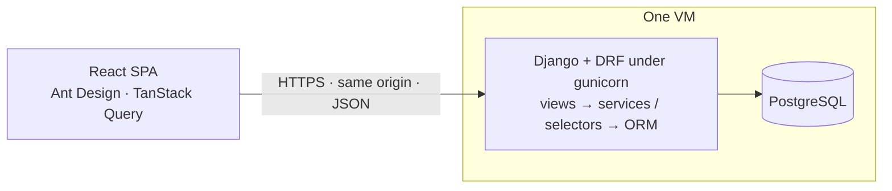
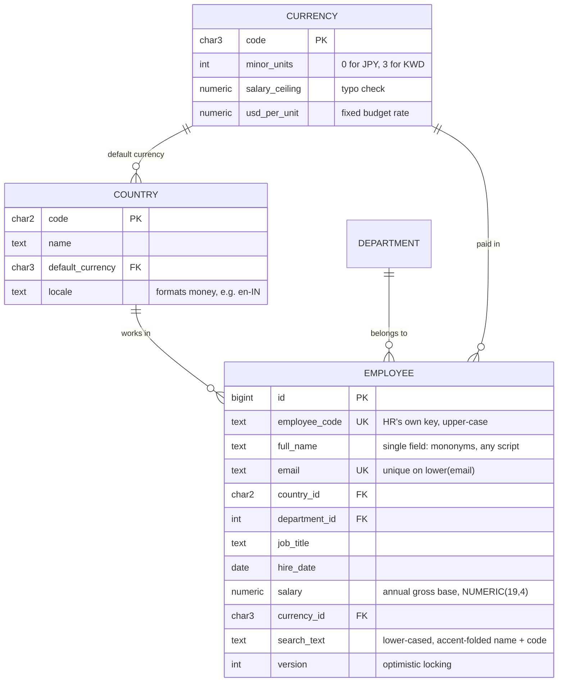
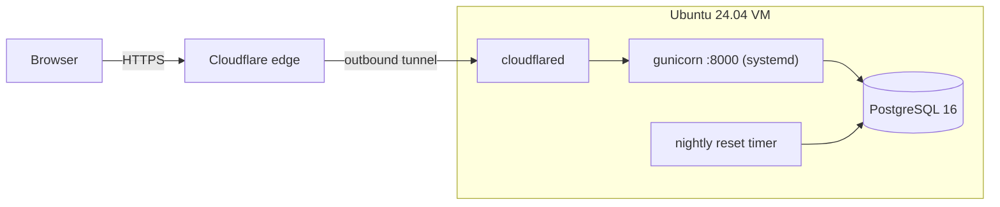

# 02 · Design

Companion to [`01-requirements.md`](01-requirements.md). Edge cases are catalogued in [`03-edge-cases.md`](03-edge-cases.md); sequencing is in [`04-build-plan.md`](04-build-plan.md).

## 1. Shape of the problem

| Dimension | Size | Consequence |
|---|---|---|
| Employees | 10,000; headroom to ~100k | The whole dataset is a few MB and stays in database memory. An aggregate over everyone takes milliseconds. |
| Writers | One HR Manager persona; maybe a few people at once | Contention is negligible, but two people editing one employee must still be detected. |
| Sensitivity | Pay data | HTTPS, private caching and log hygiene even for the demo. |

The hard parts are **correctness** (money, currencies, rounding, concurrent edits) and **product** (turning records into answers). Throughput is not, so the design spends its complexity there.

## 2. Architecture



- **One process, one origin.** gunicorn runs Django, which serves the API and the built React app: its hashed files through WhiteNoise, and `index.html` for every other address with `Cache-Control: no-cache`, so the page carries the security headers and a deploy shows on the next load. No CORS, no second server. Postgres is the only other moving part.
- **Layers.** DRF views and serializers deal with HTTP only. `services` own writes: the transaction, the rules and the version check. `selectors` own reads and the analytics queries. A pure `domain` package (money, FX conversion, statistics, text rules) imports nothing from Django and carries most unit tests. import-linter enforces the boundary in CI.
- **Synchronous by choice.** Every request is a few milliseconds of database work, so async views would add complexity without making anything faster. N+1 queries are caught by query-count assertions on every list and detail endpoint.

### Decisions

| # | Decision | Instead of | Why | Revisit when |
|---|---|---|---|---|
| D1 | Django 5.2 LTS + Django REST framework | Django Ninja; FastAPI | LTS with security fixes until 2028; serializers, pagination and OpenAPI (drf-spectacular) built in; most Django teams know it. | The next LTS. |
| D2 | Synchronous views under gunicorn threads | Async on ASGI | Requests are short database reads. | A feature needing long-lived connections. |
| D3 | PostgreSQL | SQLite | `percentile_cont` for the statistics, trigram search, concurrent writers. | — |
| D4 | The **current salary is two columns on the employee**: amount and currency | A salary-history table | The brief asks for current salary only. One row per person keeps every query a plain scan of `employees`. | History is wanted: add an effective-dated table and derive the current salary from it. |
| D5 | Money is `NUMERIC(19,4)` plus an ISO-4217 code, sent as strings, rounded half-up to the currency's minor unit only when written out | Floats; django-money | Exact; covers 0-, 2- and 3-decimal currencies; strings survive JavaScript. `percentile_cont` returns `double precision`, so its results are cast back to `numeric`. | — |
| D6 | **Fixed exchange rates as reference data**: one `usd_per_unit` per currency | Dated rate history; a live feed | The brief allows fixed rates; finance reports at budget rates; a feed is a point of failure. Converting A→B goes through USD. | Rates that change during the year: a dated rate table. |
| D7 | Offset pagination with a stable tie-breaker | Keyset pagination | HR expects page numbers and totals; `OFFSET` over 10k rows costs nothing. | ~1M rows. |
| D8 | Analytics in SQL: parameterized CTEs with allow-listed pieces | Loading rows into pandas | Data stays in the database; one round trip per answer. | OLAP scale: rollups. |
| D9 | No sign-in; the demo resets nightly | Sessions and roles | The brief asks for one persona and no authentication. Anyone can reach the demo, so a timer reseeds it every night. | Real data: sign-in first (§9). |
| D10 | Deploy with a shell script and systemd on one VM | Containers; a platform | No hosting preference; one VM is enough, and plain scripts are easy to read. | More than one machine. |

### Configuration

Assumptions are not hard-coded, so a different answer changes configuration, not code. Settings come from environment variables with defaults in `config/settings/base.py`; reference data comes from a migration.

| Assumption | Lives in | Default |
|---|---|---|
| Reporting currency | setting `REPORTING_CURRENCY` | `USD` |
| Currencies, their decimals, typo ceilings and fixed rates | reference data (`currencies`) | nine currencies, 2026 budget rates |
| Countries and their default currency and locale | reference data (`countries`) | ten countries |
| Departments | reference data (`departments`) | ten departments |
| Dashboard questions | explorer presets, a data list in `analytics/presets.py` | the breakdowns in 01 |
| Smallest group treated as reliable (peers, `low_sample`) | setting `MIN_GROUP_SIZE` | 5 |
| Organization time zone (today, tenure) | setting `ORG_TIME_ZONE` | `UTC` |

A bad value stops `manage.py check`, `migrate` and the server with a clear message (`apps/core/checks.py`).

## 3. Data model



**Rules live in the database, not only in serializers.** `UniqueConstraint(Lower("email"))` · unique employee code · `CheckConstraint`s for `salary > 0`, non-blank names and codes, ISO codes, positive rates and ceilings. Migrations also create the `pg_trgm` extension.

**Indexes that matter:** `employees (country_id, department_id)` for filters and group-bys · `employees (job_title)` for peers · a `GinIndex` with `gin_trgm_ops` on `search_text`.

`search_text` is built in Python by one domain function (NFKD, accents stripped, lower-cased) that the services and the seed both call. Search uses `contains` on the folded term, which the trigram index serves (`icontains` renders as `UPPER(…) LIKE`, which it can't).

**The query insights build on** lives in `analytics/sql.py` and runs with bound parameters; the explorer adds a `GROUP BY` from allow-listed dimensions and metrics:

```sql
WITH base AS (
  SELECT e.id, e.country_id, c.name AS country_name, e.department_id, d.name AS department_name,
         e.job_title, e.hire_date,
         e.salary * cur.usd_per_unit / %(target_rate)s AS pay
  FROM   employees e
  JOIN   countries c   ON c.code = e.country_id
  JOIN   departments d ON d.id = e.department_id
  JOIN   currencies cur ON cur.code = e.currency_id
  WHERE  TRUE {filters}
)
SELECT ... FROM base ...
```

`target_rate` is the chosen currency's rate. A currency the app doesn't know is a 422 naming it; every stored salary has a rate, because its currency is a foreign key and every currency's rate is required and positive.

## 4. Analytics: what each number means

Every answer states its `currency` and its FX basis ("converted through USD at fixed budget exchange rates").

| Term | Definition |
|---|---|
| Headcount | Employees in scope (the filters: countries, departments) |
| Payroll | Sum of annual salaries, converted into the answer's currency |
| Mean, median, P10–P90, min, max | Of the converted salaries; percentiles by `percentile_cont` (linear interpolation) |
| Low sample | A group with fewer than `MIN_GROUP_SIZE` people: shown, but flagged |
| Tenure band | Whole years since the hire date, on today in the organization time zone: under 1, 1–2, 3–4, 5–9, 10+ |
| Peer group | Same job title and country; with fewer than 5 such peers, same job title in every country. The employee is not their own peer, and the answer names the group used |
| Peer position | In the currency of the employee's country: the peers' P10–P90, the employee's percentile rank (share of peers paid less, ties counting half) and compa-ratio (salary ÷ peer median) |

**Explorer.** One allow-listed endpoint answers ad-hoc questions: up to five *metrics* (headcount, payroll, mean, median, P10, P25, P75, P90, min, max) × up to two *dimensions* (country, department, job title, tenure) × *filters* × `currency`. The dashboard's cards are saved presets of it, so changing a question means editing a list.

## 5. Concurrent edits

Every employee goes out with its `version` as an `ETag`. A write (edit, salary change, delete) sends it back in `If-Match`; the service locks the employee row (`select_for_update`), compares, applies the change and bumps the version, all in one transaction. A stale version gets 412 with the current one, and the app offers Reload, which shows the other person's record in place of what was typed. A write without `If-Match` gets 428. A double-clicked Save on a new employee is a 409 pointing at the record the first click made, because the code and email are unique.

## 6. Salary changes

The salary is edited like any other field, never optimistically. The Change salary dialog takes either a new amount and currency or a raise in %, and shows the exact result before saving, rounded half-up to the currency's minor unit: `₹18,00,000 → ₹19,26,000 (+7.0%)`. It always sends the absolute amount it showed, never a %, so what is saved is what was previewed. The same rounding rules run in Python and TypeScript and share one set of golden test vectors (`shared/money-vectors.json`).

## 7. API

DRF under `/api/v1/`. JSON; money as strings; ISO-8601 dates; errors as RFC 9457 `problem+json` with field-level details, each carrying the request id. Errors Django answers outside DRF take the same form under `/api/`: an unknown address is a 404 problem, and an unhandled error is a 500 problem with the request id and never the error itself. Lists take `page` and `page_size` (capped at 200); a page past the end is empty with the total, not a 404. Every query parameter is allow-listed by a query serializer: an unknown parameter or sort key is a 400 naming it, and every sort ends with `id`. drf-spectacular publishes the OpenAPI schema and Swagger UI at `/api/docs/`.

| Area | Endpoints |
|---|---|
| Employees | `GET, POST /employees/` · `GET, PATCH, DELETE /employees/{id}/` (writes need `If-Match`) · `GET /employees/{id}/peers/` |
| Insights | `GET /analytics/summary/` · `GET /analytics/explore/` (each takes `currency`, `country`, `department`) · `GET /analytics/presets/` |
| Reference | `GET /reference/countries/`, `departments/`, `currencies/` (with fixed rates) |
| Settings | `GET /config/`: the reporting currency and today in the organization's time zone |
| Operations | `GET /healthz/` (the process answers) · `GET /readyz/` (the database answers) |

## 8. Frontend

| Screen | Purpose |
|---|---|
| Insights | Headcount, payroll, median and mean; payroll and ranges by country and department; salary by job title; the explorer. Currency, country and department in a scope bar |
| Employees | Server-side search, filters, sort and paging, with each salary in its own currency |
| Employee | Details, current salary with Change salary, peers, Edit and Delete |
| Add employee | Details and salary; the currency defaults to the country's |

- **The URL holds view state** (filters, sort, page, currency), so views are shareable and Back works.
- **Server state lives in TanStack Query**: no global store; previous data kept while paging; a record prefetched while the pointer is on its row; caches invalidated after each save.
- **Money is formatted in the currency's locale**: `en-IN` gives ₹18,00,000; yen has no decimals.
- **Look.** A dark sidebar with the two sections; white cards on light grey; Inter (bundled, so the CSP needs no exception) with an indigo accent; people shown with their initials in a coloured circle. Desktop screens only.
- **Accessible to WCAG 2.2 AA at desktop sizes.** A theme over Ant Design's (`lib/theme.ts`) brings every text colour to 4.5:1. One heading per page, which also names the tab; a skip link; every field labelled. axe checks every page in the end-to-end tests.
- **Charts are HTML and CSS**, because the questions compare a handful of groups. Each group's name and value are text, so a screen reader reads them; rows share one grid (CSS subgrid), so every bar is drawn to one scale. Every view has loading, empty and error states, and a fault shows the request id to quote.

## 9. Security and privacy

- **No sign-in**, by the brief (D9). The demo holds generated data only and is reset every night at 03:00 UTC. Before real data, the first job is sign-in (Django sessions with CSRF, which the SPA's same-origin design already suits), then roles and an audit log.
- **Input**: explicit serializer fields, with `id`, `version` and timestamps read-only; allow-listed sorts and filters; ORM or parameterized SQL only.
- **Headers**: `manage.py check --deploy` gates CI and every deploy: `DEBUG=False`, HSTS, SSL redirect behind the tunnel (`SECURE_PROXY_SSL_HEADER`), `X-Frame-Options: DENY`, `nosniff`. A Content Security Policy from django-csp: only this site's scripts, never inline ones (the API docs load Swagger UI from our own static files); inline styles allowed for Ant Design; no framing, plugins or `<base>`.
- **Caching**: every API response is `Cache-Control: private, no-cache`, so no shared cache keeps pay data.
- **Logs**: gunicorn's access log; salaries, names, emails and request bodies are never logged.

## 10. Deployment and performance



- **One-time setup** (`deploy/setup-vm.sh`, as root): installs PostgreSQL, uv and cloudflared; creates the database, the secrets in `/opt/acme-salary/.env` (readable by the `deploy` user only), the `deploy` user (SSH key only; may restart the app and nothing else), the app's systemd unit, the nightly reset timer, and the tunnel.
- **Public address.** A Cloudflare quick tunnel dials out from the VM, giving an HTTPS address on `trycloudflare.com` with no open ports and no certificate to manage. `deploy.sh` prints the current address.
- **Every deploy** (`deploy/deploy.sh`, run by CI on each green push to `main`, or by hand) builds the React app, uploads a new release directory, installs the locked dependencies with uv, runs `check --deploy`, `collectstatic` and `migrate`, then points `current` at the release and restarts gunicorn. It waits for `/readyz/`, seeds an empty database, keeps the last five releases, and checks the public address answers. Anything failing before the switch leaves the previous release serving; rollback is pointing `current` back and restarting.
- **Database settings**: psycopg 3 with Django's connection pool; Postgres bounds every statement (`statement_timeout = 10s`, `lock_timeout = 8s`, `idle_in_transaction_session_timeout = 60s`), because gunicorn's timeout doesn't under threads.

| Operation | Budget (server) | How |
|---|---|---|
| Directory page with filters, sort and total | < 100 ms | Indexed filters; `select_related`; 2 queries, pinned by a test |
| Any insight | < 200 ms | One SQL aggregate over 10k rows; 2 queries |
| Peers | < 100 ms | One indexed query on job title; 3 queries |
| Seed 10,000 employees | < 5 s | Generated in memory; `bulk_create` in batches (about 1 s) |

**Scaling path:** at ~100k employees, cache the insights by a data version and add a second gunicorn host; at ~1M, keyset pagination and pre-aggregated rollups.

## 11. Testing

| Layer | Tools | What it covers |
|---|---|---|
| Domain unit | pytest, Hypothesis | Rounding and currency precision, conversion, percentiles, peer fallback, text rules — no database |
| API integration | pytest-django against real Postgres, each test rolled back | CRUD and validation, 409/412/428, query-count ceilings, insights on a small hand-computed company, seed, security headers, error bodies |
| Frontend | Vitest, Testing Library, stubbed `fetch` | Forms, URL state, raise preview maths, error display |
| End-to-end | Playwright in Chromium against the built app served by Django (`make e2e`) | A raise, add then delete, the two-person clash, chart scale, headcount; axe on every page and dialog |

Determinism: an injected clock (no `date.today()` in business logic), fixed random seeds, no network. CI runs ruff, mypy (strict, with django-stubs), import-linter, `makemigrations --check`, `check --deploy` and pytest with a 90% coverage gate; then ESLint, tsc, Vitest and the build; then the browser tests; then, on `main`, the deploy.

## 12. Seed data

`manage.py seed` creates 10,000 employees across ten countries, including Japan (no minor unit), Kuwait (three) and Indonesia (huge nominal amounts), with locale-appropriate names from Faker. Salary = a base for seniority × a department factor × a country factor × log-normal noise, converted at the fixed rates and rounded to a sensible step per currency; seniority shapes the job title (Associate, Senior, Lead, Principal, Director). About 1% are planted far from their peers. A fixed seed gives identical data on every run. It runs only when `ENV` is `dev`, `test` or `demo`, and needs `--reset` to replace existing data.

## 13. Repository layout

```
acme-salary/
├── docs/                 questions, requirements, design, edge cases, plan, AI usage
├── backend/
│   ├── config/           settings/{base,dev,test,e2e,prod}.py, urls.py, wsgi.py
│   ├── domain/           pure Python: money, fx, stats, text
│   ├── apps/
│   │   ├── core/         clock, errors, request id, health, checks, the SPA view
│   │   ├── reference/    countries, currencies with fixed rates, departments
│   │   ├── employees/    model · services · selectors · API · seed command
│   │   └── analytics/    SQL, selectors and API (read-only)
│   └── tests/            unit/, integration/
├── frontend/src/         api/, features/{insights,employees,salaries,reference}/, components/, lib/
├── e2e/                  Playwright
├── deploy/               setup-vm.sh, deploy.sh
└── .github/workflows/ci.yml
```
